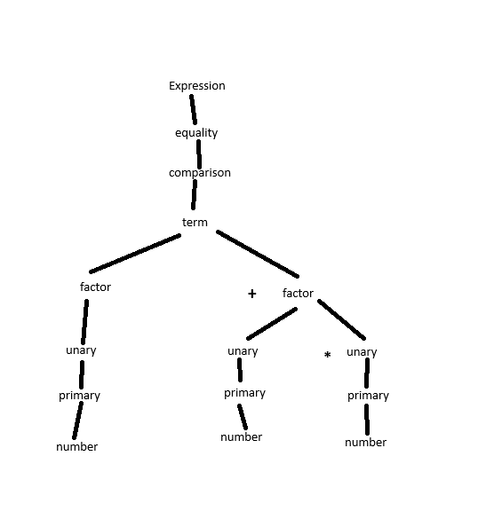

# Lab 3 Parser
Name: Mongo
File extension: .mng
Written in Python

## Grammar

expression → equality ;
equality → comparison ( ( "!=" | "==" ) comparison )* ;
comparison → term ( ( ">" | ">=" | "<" | "<=" ) term )* ;
term → factor ( ( "-" | "+" ) factor )* ;
factor → unary ( ( "/" | "*" ) unary )* ;
unary → ( "!" | "-" ) unary | primary ;
primary → NUMBER | STRING | "true" | "false" | "nil" | "(" expression ")" ;

## Precedence and Associativity

lowest to highest

Equality == != left
Comparison > >= < <= left
Term - + left
Factor / * left
Unary ! - right

## Design Choices

Same as chapter 6 in the book but in Python.

only thing different from the book is it reports extra tokens after the expression
because the lab said to. the book just ignores them. it gives Expect end of expression.

python cant have two methods named error so the one that takes a token is token_error
in src/error_handler.py.

synchronize is in there like the book but its not used yet.

## Files

src/parser.py         the parser
src/mongo.py          entry point now scans, parses and prints the AST
src/error_handler.py  added token_error
src/scanner.py, src/token.py, src/token_type.py, src/expr.py, src/ast_printer.py  from labs 1 and 2
test/lab3/            the tests

## Setup

Nothing to install. Just Python.

## Running

ran it from my root folder.

Interactive mode
python src\mongo.py

Source file mode
python src\mongo.py test\lab3\literals.mng

tests
python src\mongo.py test\lab3\literals.mng
python src\mongo.py test\lab3\arithmetic.mng
python src\mongo.py test\lab3\comparison.mng
python src\mongo.py test\lab3\unary.mng
python src\mongo.py test\lab3\precedence.mng
python src\mongo.py test\lab3\associativity.mng
python src\mongo.py test\lab3\nested_unary.mng
python src\mongo.py test\lab3\grouping.mng
python src\mongo.py test\lab3\unmatched_paren.mng
python src\mongo.py test\lab3\missing_operand.mng
python src\mongo.py test\lab3\missing_left_operand.mng
python src\mongo.py test\lab3\unexpected_token.mng
python src\mongo.py test\lab3\trailing_token.mng
python src\mongo.py test\lab3\extra_paren.mng
python src\mongo.py test\lab3\empty.mng
python src\mongo.py test\lab3\lexical_error.mng

## Test 1 literals.mng

every literal type

1 == 2.5 != "hello" == true != false == nil

Expected: (== (!= (== (!= (== 1.0 2.5) hello) True) False) nil)
Actual: (== (!= (== (!= (== 1.0 2.5) hello) True) False) nil)
matches

## Test 2 arithmetic.mng

the + - * / operators

1 + 2 - 3 * 4 / 5

Expected: (- (+ 1.0 2.0) (/ (* 3.0 4.0) 5.0))
Actual: (- (+ 1.0 2.0) (/ (* 3.0 4.0) 5.0))
matches

## Test 3 comparison.mng

all the comparison and equality operators

1 < 2 == 3 <= 4 != 5 > 6 == 7 >= 8

Expected: (== (!= (== (< 1.0 2.0) (<= 3.0 4.0)) (> 5.0 6.0)) (>= 7.0 8.0))
Actual: (== (!= (== (< 1.0 2.0) (<= 3.0 4.0)) (> 5.0 6.0)) (>= 7.0 8.0))
matches

## Test 4 unary.mng

unary - and !

-1 * !true

Expected: (* (- 1.0) (! True))
Actual: (* (- 1.0) (! True))
matches

## Test 5 precedence.mng

slide example with every level in it

1 == 42 < 42 + -42 / 2

Expected: (== 1.0 (< 42.0 (+ 42.0 (/ (- 42.0) 2.0))))
Actual: (== 1.0 (< 42.0 (+ 42.0 (/ (- 42.0) 2.0))))
matches

## Test 6 associativity.mng

left associative

5 - 3 - 1

Expected: (- (- 5.0 3.0) 1.0)
Actual: (- (- 5.0 3.0) 1.0)
matches

## Test 7 nested_unary.mng

unary is right associative, slide example

---12

Expected: (- (- (- 12.0)))
Actual: (- (- (- 12.0)))
matches

## Test 8 grouping.mng

nested groups

((1 + 2)) * (3 - (4 / 5))

Expected: (* (group (group (+ 1.0 2.0))) (group (- 3.0 (group (/ 4.0 5.0)))))
Actual: (* (group (group (+ 1.0 2.0))) (group (- 3.0 (group (/ 4.0 5.0)))))
matches

## Test 9 unmatched_paren.mng

(1 + 2

Expected: [line 1] Error at end: Expect ')' after expression.
Actual: [line 1] Error at end: Expect ')' after expression.
matches

no closing paren so it hits the end looking for one.

## Test 10 missing_operand.mng

1 + 2 -

Expected: [line 1] Error at end: Expect expression.
Actual: [line 1] Error at end: Expect expression.
matches

nothing after the - so primary has nothing to match.

## Test 11 missing_left_operand.mng

`* 2`

Expected: [line 1] Error at '*': Expect expression.
Actual: [line 1] Error at '*': Expect expression.
matches

an expression cant start with * so primary errors on it.

## Test 12 unexpected_token.mng

1 + var

Expected: [line 1] Error at 'var': Expect expression.
Actual: [line 1] Error at 'var': Expect expression.
matches

var isnt a literal or a paren so primary errors on it.

## Test 13 trailing_token.mng

1 + 2 3

Expected: [line 1] Error at '3': Expect end of expression.
Actual: [line 1] Error at '3': Expect end of expression.
matches

1 + 2 parses fine but the 3 is left over.

## Test 14 extra_paren.mng

(1 + 2))

Expected: [line 1] Error at ')': Expect end of expression.
Actual: [line 1] Error at ')': Expect end of expression.
matches

the group parses fine but the second ) is left over.

## Test 15 empty.mng

empty file

Expected: [line 1] Error at end: Expect expression.
Actual: [line 1] Error at end: Expect expression.
matches

only token is EOF so there is nothing to parse.

## Test 16 lexical_error.mng

1 + @2

Expected: [line 1] Error at '@': Unexpected character.
Actual: [line 1] Error at '@': Unexpected character.
matches

the scanner errors on @. the rest parses but it doesnt print the AST because there
was an error.

## Test 17 interactive mode

typed these in one at a time
1 + 2 * 3
(1 + 2
1 + 2 3
-(4 - 1)

Expected
(+ 1.0 (* 2.0 3.0))
[line 1] Error at end: Expect ')' after expression.
[line 1] Error at '3': Expect end of expression.
(- (group (- 4.0 1.0)))

Actual
>>>>> Mongo Interactive Shell <<<<<
> (+ 1.0 (* 2.0 3.0))
> [line 1] Error at end: Expect ')' after expression.
> [line 1] Error at '3': Expect end of expression.
> (- (group (- 4.0 1.0)))
>
matches

last line still works after the two errors.

## Syntax Tree

1 + 2 * 3

Printed AST: (+ 1.0 (* 2.0 3.0))

the + is in term so its the top Binary. the * is in the second factor so its a Binary
under the +. the other rules only have one child so they just pass it up and dont
show in the AST.